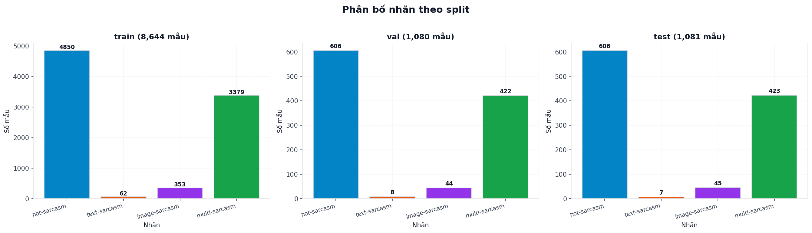
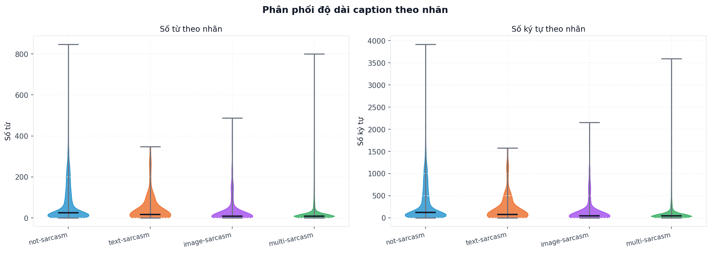
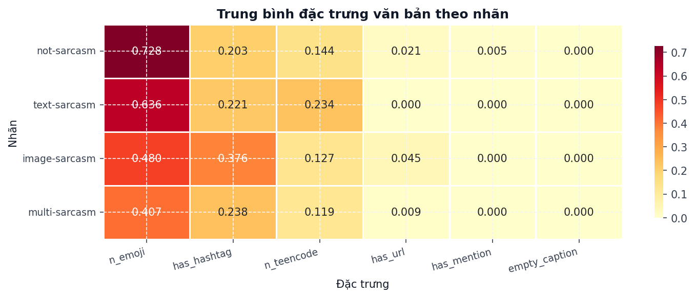
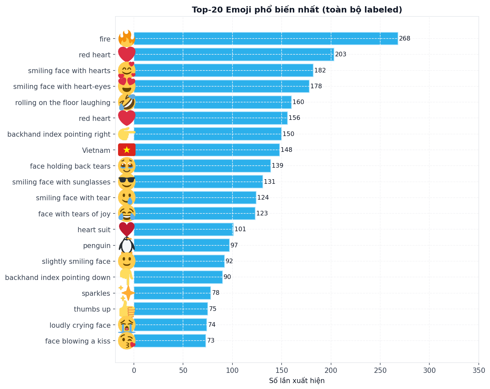
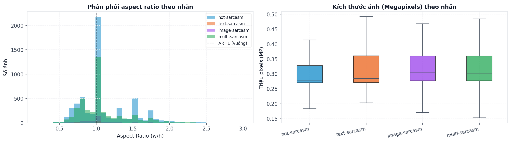

# 2.1. EDA

- **Phase:** 2, EDA và tiền xử lý dữ liệu
- **Nguồn:** `notebooks/00_dataset_check.ipynb` (chạy trên Kaggle ngày 26/09/2026, kết quả thô ở `working/dataset_check.json`), `notebooks/01_eda.ipynb`, `reports/results/dataset_report.md`, `reports/results/eda_summary.md`, `reports/results/empirical_phase0.md`
- **Hình:** `reports/figures/dataset_*.png`, `reports/figures/eda_*.png`

Lúc chạy kiểm tra dữ liệu, hai tập test chưa có nhãn. Phân bố nhãn của public/private test ở mục 2 lấy từ file nhãn của `phuclkz/vimmsd-private-dataset`, được bổ sung sau.

---

## 1. Tính toàn vẹn

Dữ liệu sạch về cấu trúc, đạt mọi kiểm tra tự động (43 kiểm tra):

| Thành phần | Số mẫu | Dung lượng ảnh |
|---|---:|---:|
| `vimmsd-train.json` + `train-images/` | 10.805 | 864,6 MB |
| `vimmsd-public-test.json` + `dev-images/` | 1.413 | 81,7 MB |
| `vimmsd-private-test.json` + `test-images/` | 1.504 | 81,1 MB |

- Mọi mẫu đủ 3 trường `image`, `caption`, `label`; id train không trùng; nhãn chỉ thuộc 4 lớp.
- Không thiếu ảnh (0/10.805, 0/1.413, 0/1.504), không có ảnh thừa, mỗi ảnh thuộc đúng 1 mẫu.
- Toàn bộ 13.722 ảnh mở và giải mã được, không có ảnh động.

## 2. Phân bố nhãn

| Split | Số mẫu | not | text | image | multi |
|---|---:|---:|---:|---:|---:|
| train | 10.805 | 6.062 (56,1%) | 77 (0,7%) | 442 (4,1%) | 4.224 (39,1%) |
| public test (val) | 1.413 | 442 (31,3%) | **1** (0,1%) | 28 (2,0%) | 942 (66,7%) |
| private test (test) | 1.504 | 458 (30,5%) | **7** (0,5%) | 40 (2,7%) | 999 (66,4%) |

**Nhận xét:**

- **Mất cân bằng 78,2 lần** giữa lớp lớn nhất và nhỏ nhất. Một mô hình chỉ đoán `not-sarcasm` có accuracy 56% trên train nhưng macro-F1 khoảng 0,18, nên bắt buộc dùng macro-F1.
- **Lệch phân bố nhãn (label shift):**

| | train | public test | private test |
|---|---:|---:|---:|
| P(có châm biếm) | 43,9% | 68,7% | 69,5% |
| P(`multi` \| có châm biếm) | 89,1% | 97,0% | 95,5% |

- Luôn đoán `multi-sarcasm` đạt accuracy 66,7% trên val. Mô hình học prior của train sẽ đoán `not-sarcasm` nhiều hơn mức cần ở test.
- `text-sarcasm` chỉ có 1 mẫu val và 7 mẫu test. F1 lớp này trên val chỉ là 0 hoặc 1 nhưng chiếm 1/4 macro-F1, nên các phase sau dùng thêm macro-F1 3 lớp.

## 3. Caption

### 3.1. Độ dài

| Split | Trung bình (từ) | Trung vị | 75% | Lớn nhất |
|---|---:|---:|---:|---:|
| train | 50,7 | 15 | 54 | 846 |
| public test | 26,1 | 8 | 16 | 708 |
| private test | 27,7 | 8 | 18 | 513 |

| Nhãn (train) | Trung bình | Trung vị | 75% |
|---|---:|---:|---:|
| not-sarcasm | 72,0 | 25 | 107 |
| text-sarcasm | 45,7 | 17 | 39 |
| image-sarcasm | 32,8 | 8 | 21 |
| multi-sarcasm | 22,2 | 9 | 17 |

- **Độ dài phụ thuộc mạnh vào nhãn.** `not-sarcasm` thường là tin tức hoặc quảng cáo dài; `image` và `multi` là caption meme ngắn (trung vị 8–9 từ). Đây là một shortcut tiềm năng ("caption dài → không mỉa mai").
- Caption ở hai tập test ngắn bằng khoảng một nửa train (trung vị 8 so với 15 từ), khớp với tỉ lệ meme cao hơn ở test.
- p95 độ dài là 230 từ. 12% caption dài hơn 128 từ, chủ yếu thuộc `not-sarcasm`.

### 3.2. Tín hiệu bề mặt

Tỉ lệ % caption có hiện tượng:

| Hiện tượng | train | public test | private test |
|---|---:|---:|---:|
| HTML entity (`&amp;`…) | 2,1 | 1,6 | 1,7 |
| URL | 1,7 | **7,0** | **8,8** |
| Hashtag | 22,4 | 21,3 | 20,9 |
| Emoji | **30,7** | 17,3 | 19,2 |
| Emoticon (`=)))`, `:)))`) | 7,9 | **25,5** | **24,3** |
| Chữ lặp (`quáaaa`) | 4,3 | 3,4 | 3,1 |

Theo nhãn trong train:

| Hiện tượng | not | text | image | multi |
|---|---:|---:|---:|---:|
| Hashtag | 20,3 | 22,1 | **37,6** | 23,8 |
| Emoji | 33,7 | 29,9 | 25,6 | 26,8 |
| Emoticon | 5,7 | **18,2** | 9,7 | 10,8 |
| URL | 2,1 | 0,0 | 4,5 | 0,9 |

- Emoticon `=)))`, `:)))` ở test phổ biến gấp 3 lần train và cao nhất ở `text-sarcasm`: đây là tín hiệu châm biếm tiếng Việt, cần **giữ lại** khi tiền xử lý.
- `image-sarcasm` có tỉ lệ hashtag cao nhất (37,6%). Nhiều hashtag là **tên trang meme** (`#interpool`, `#WMO`, `#WorldMemeOrganization`, `#VOZ_F33`), tức là nguồn đăng bài chứ không phải nội dung. Phase 9 và 10 kiểm tra tín hiệu này.
- Emoji phổ biến nhất (train): ❤ 435, 🔥 359, 🤣 247, 🥰 203, 😍 198.

### 3.3. Caption trùng lặp

- **2.860 mẫu train (26,5%)** có caption trùng với ít nhất một mẫu khác, thuộc 697 nhóm.
- **123 nhóm trùng caption nhưng khác nhãn.** Ví dụ `:))` xuất hiện 34 lần với 3 nhãn (multi 12, not 11, image 11), `-kem` 23 lần với cả 4 nhãn.
- Tra bảng "caption → nhãn phổ biến nhất của nhóm" đoán đúng **93,6%** số mẫu có caption trùng.
- Caption gắn thẻ trang meme lặp nhiều: `- Elsa #interpool #WMO …` xuất hiện 24 lần, 21 lần là `image-sarcasm`.

*Cùng caption `#Interpool -Ivan`, ảnh trái là `multi-sarcasm`, ảnh phải là `image-sarcasm`: nhãn do ảnh quyết định.*

Nhóm trùng caption khác nhãn là nơi **bắt buộc phải dùng ảnh**, nên là tập con tốt để kiểm tra mô hình có dùng ảnh không (dùng ở Phase 10).

## 4. Ảnh

| Split | Rộng (trung vị) | Cao (trung vị) | Tỉ lệ rộng/cao (min–max) | Dung lượng TB |
|---|---:|---:|---|---:|
| train | 526 | 526 | 0,16 – 6,38 | 78 KB |
| public test | 526 | 527 | 0,37 – 4,35 | 56 KB |
| private test | 526 | 528 | 0,43 – 7,25 | 53 KB |

- Ảnh khá đồng nhất, phần lớn gần vuông, lớn hơn đầu vào 224×224 của CLIP.
- **72 ảnh có tỉ lệ > 3:1** (ảnh chụp chuỗi bình luận, meme nhiều khung). Center crop của CLIP sẽ cắt mất phần lớn nội dung, nên Phase 2.3 chuyển sang pad vuông.
- 1.265 ảnh (9,2%) là PNG nhưng đuôi `.jpg`; 7 ảnh có cạnh < 100 px; 3 ảnh thang xám. Không gây lỗi.
- **Ảnh trùng (md5):** 84 file thuộc 42 nhóm; 20 nhóm nằm ở nhiều split; 9 nhóm trong train mang nhãn khác nhau.

## 5. Trùng lặp giữa các split chính thức

Caption chuẩn hoá hoặc md5 ảnh (`empirical_phase0.md` §1):

| Cặp | Trùng caption | Trùng ảnh | Một trong hai | Cả hai |
|---|---:|---:|---:|---:|
| train ↔ public test (1.413) | 54 | 5 | 59 (4,2%) | 0 |
| train ↔ private test (1.504) | 71 | 12 | 83 (5,5%) | 0 |
| public ↔ private test | 42 | 3 | 45 (3,0%) | 0 |

Không mẫu test nào trùng train cả caption lẫn ảnh. Phần trùng một nửa là đặc điểm của benchmark chính thức, được báo cáo chứ không sửa.

## 6. Quan sát định tính

| Lớp | Đặc điểm thường gặp |
|---|---|
| `text-sarcasm` | ảnh chụp bình thường (người, cảnh vật), ý mỉa mai nằm trong caption |
| `image-sarcasm` | phần lớn là meme **có chữ trong ảnh** (biển báo, truyện tranh, ảnh chụp bình luận) |
| `multi-sarcasm` | meme hoặc ảnh chụp màn hình có chữ, caption ngắn kèm emoticon `:))` |
| `not-sarcasm` | ảnh sự kiện, quảng cáo, tin tức, caption dài |

- Ở `image` và `multi`, nội dung mỉa mai thường nằm trong **chữ trên ảnh**. CLIP đọc chữ hạn chế, nên đồ án trích OCR (Phase 2.3).
- Ranh giới `image-sarcasm` / `multi-sarcasm` khó phân biệt ngay cả bằng mắt: cả hai đều là meme có chữ với caption ngắn.

## 7. Kết luận và tác động lên thiết kế

| Phát hiện | Quyết định |
|---|---|
| Mất cân bằng 78 lần, lớp hiếm cực ít ở val/test | macro-F1 là chỉ số chính; báo thêm macro-F1 3 lớp; 3 seed cho mỗi cấu hình; Phase 8 xử lý mất cân bằng |
| Label shift train → test | Thử hiệu chỉnh prior (Phase 6); báo cáo F1 từng lớp |
| Caption trùng, nhóm trùng khác nhãn | Split nội bộ theo nhóm (`StratifiedGroupKFold`) cho Phase 10; tập con trùng caption khác nhãn để kiểm tra việc dùng ảnh |
| Thẻ trang nguồn tương quan với nhãn | Kiểm tra shortcut thẻ nguồn (Phase 9, 10) |
| Emoticon là tín hiệu châm biếm | Giữ emoticon khi tiền xử lý (Phase 2.2) |
| HTML entity, Unicode chưa NFC | Thêm `html.unescape`, chuẩn hoá NFC (Phase 2.2) |
| Ảnh tỉ lệ cực đoan | Pad vuông thay cho center crop (Phase 2.3) |
| Chữ trong ảnh mang ý mỉa mai | Trích OCR và mô tả ảnh (Phase 2.3) |
