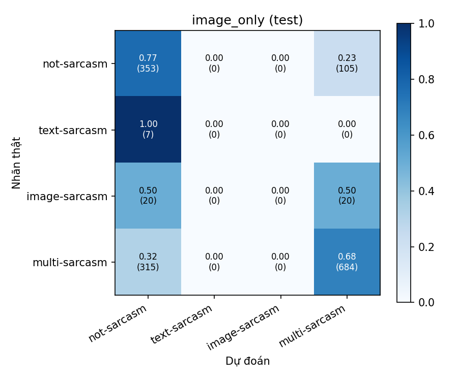
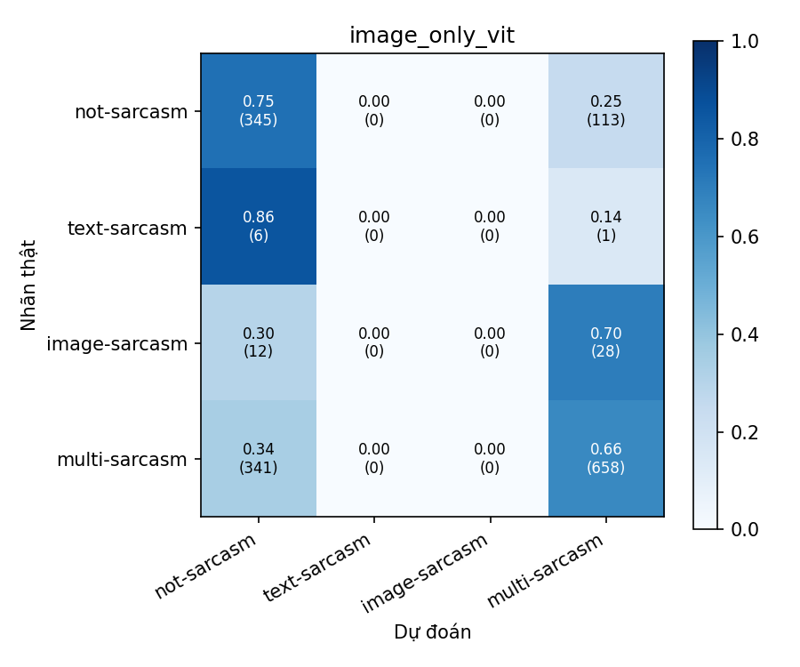
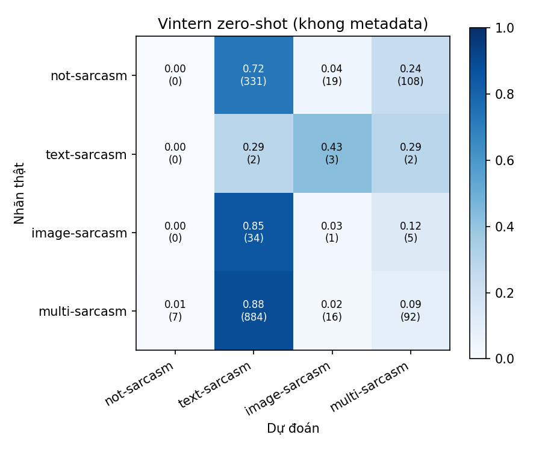
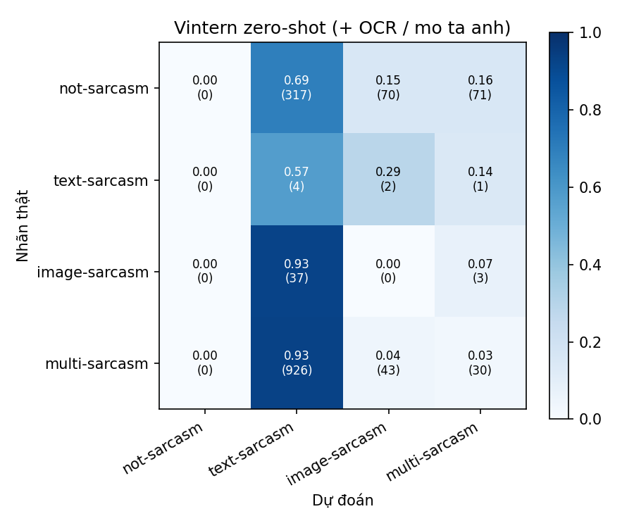

# 3.3. Image-only: CLIP, ViT và VLM với metadata

- **Phase:** 3, Baseline đơn modality
- **Configs:** `configs/image_only.yaml` (CLIP fine-tune), `configs/image_only_vit.yaml` (ViT fine-tune), `configs/image_only_frozen.yaml` (CLIP đóng băng); VLM: `configs/base.yaml` + `data.image_text.use_ocr/use_description`
- **Notebook:** `notebooks/03_baseline_image.ipynb` (Task 5, 6, 7), `notebooks/01b_image_text_extraction.ipynb` (metadata)
- **Nguồn số liệu:** `reports/word/Fine-tune CLIP.docx` (Task 5–10, Kaggle T4, commit `646475c`), `reports/results/results.md` (Phase 4, plan `denoise_compare`)
- **Tập đánh giá:** private test 1.504 mẫu (not 458, text 7, image 40, multi 999)
- **Hình:** `reports/figures/phase3_cm_*.png` (trích từ file Word)

---

## 1. Ba hướng tiếp cận

| Task | Mô hình | Pretrain | Cách dùng |
|---|---|---|---|
| 5 / 8 | CLIP ViT-B/32 (`openai/clip-vit-base-patch32`) | contrastive trên khoảng 400 triệu cặp ảnh–text | fine-tune toàn bộ vision tower + MLP head |
| 6 / 9 | ViT-B/16 (`google/vit-base-patch16-224`) | supervised trên ImageNet-21k | fine-tune toàn bộ + MLP head |
| 7 / 10 | Vintern-1B-v3.5 (`5CD-AI/Vintern-1B-v3_5`, InternVL) | VLM tối ưu cho tiếng Việt | zero-shot prompting, có và không có OCR + mô tả |

Mục tiêu: so sánh contrastive (CLIP) với supervised pretraining (ViT); fine-tune với zero-shot VLM; và xem metadata (OCR + mô tả) có giúp VLM không.

Lưu ý: Task 7 đưa cả **ảnh và caption** vào VLM, nên không còn là image-only thuần. Nó được xếp ở đây vì là hướng "vision-centric" của Phase 3.

## 2. CLIP fine-tune (Task 5/8)

### 2.1. Thiết lập

| Mục | Giá trị |
|---|---|
| Kiến trúc | CLIP vision tower → MLP 2 lớp (`head_hidden` 512, dropout 0,2) |
| Tham số train | khoảng 88M (encoder 87,8M + head 0,4M) |
| Huấn luyện | batch 16, AMP fp16, lr encoder 1e-5, lr head 1e-4, weight decay 0,01, warmup 10%, CE, sampler random |
| Dừng sớm | tối đa 10 epoch, patience 3 theo val macro-F1 4 lớp; dừng ở epoch 5, best epoch 2 |
| Val macro-F1 theo epoch | 0.2170, **0.3323**, 0.3314, 0.3168, 0.2781 |
| Tài nguyên | 1,7 phút/epoch, tổng 8,5 phút, peak VRAM 1,67 GB |
| Ghi chú chạy | caption bị loại khỏi input; truyền `--override data.text.cache_file=null` |

### 2.2. Kết quả trên private test

| Lớp | Precision | Recall | F1 | Support |
|---|---|---|---|---|
| not-sarcasm | 0.508 | 0.771 | 0.612 | 458 |
| text-sarcasm | 0.000 | 0.000 | 0.000 | 7 |
| image-sarcasm | 0.000 | 0.000 | 0.000 | 40 |
| multi-sarcasm | 0.845 | 0.685 | 0.757 | 999 |
| **Macro** | 0.338 | 0.364 | **0.3422** | 1.504 |

Accuracy 0.6895, val macro-F1 0.3323.



| thật \ dự đoán | not | text | image | multi |
|---|---:|---:|---:|---:|
| not | 353 | 0 | 0 | 105 |
| text | 7 | 0 | 0 | 0 |
| image | 20 | 0 | 0 | 20 |
| multi | 315 | 0 | 0 | 684 |

### 2.3. Nhận xét

- **Mô hình chỉ dự đoán 2 lớp** (`not` và `multi`, chiếm khoảng 95% dữ liệu): một dạng sụp về lớp đa số.
- `multi-sarcasm` tốt nhất (F1 0,757), `not-sarcasm` có recall cao nhất (0,771): ảnh không châm biếm thường là ảnh "bình thường" (sản phẩm, phong cảnh, selfie), có đặc trưng thị giác ổn định.
- `text-sarcasm` F1 = 0 là đúng kỳ vọng: ý châm biếm nằm trong caption, mô hình không được thấy caption.
- `image-sarcasm` F1 = 0 dù ý châm biếm nằm trong ảnh. Lý do khả dĩ: chỉ 442 mẫu train (4%), và phần lớn mẫu là meme có chữ, trong khi CLIP đọc chữ trong ảnh hạn chế. Ảnh của `image` và `multi` lại giống nhau về bề mặt (Phase 2.1), nên ranh giới giữa hai lớp khó học từ pixel.

## 3. ViT fine-tune (Task 6/9)

### 3.1. Thiết lập

Giống hệt Task 5 (cùng hyperparameter, cùng split), chỉ đổi encoder sang ViT-B/16 (khoảng 86M tham số train). Ablation này tách tác dụng của mục tiêu pretraining.

| Mục | Giá trị |
|---|---|
| Dừng sớm | dừng ở epoch 5, best epoch 2 |
| Val macro-F1 theo epoch | 0.3229, **0.3267**, 0.3050, 0.3086, 0.3061 (train loss vẫn giảm 0,8962 → 0,2026: overfit 2 lớp đa số) |
| Tài nguyên | 2,1 phút/epoch, tổng 10,5 phút, peak VRAM 2,33 GB |

### 3.2. Kết quả trên private test

| Lớp | Precision | Recall | F1 | Support |
|---|---|---|---|---|
| not-sarcasm | 0.490 | 0.753 | 0.594 | 458 |
| text-sarcasm | 0.000 | 0.000 | 0.000 | 7 |
| image-sarcasm | 0.000 | 0.000 | 0.000 | 40 |
| multi-sarcasm | 0.823 | 0.659 | 0.732 | 999 |
| **Macro** | 0.328 | 0.353 | **0.3313** | 1.504 |

Accuracy 0.6669, val macro-F1 0.3267. Toàn bộ 1.504 dự đoán chỉ thuộc `not` (704) và `multi` (800).



| thật \ dự đoán | not | text | image | multi |
|---|---:|---:|---:|---:|
| not | 345 | 0 | 0 | 113 |
| text | 6 | 0 | 0 | 1 |
| image | 12 | 0 | 0 | 28 |
| multi | 341 | 0 | 0 | 658 |

### 3.3. CLIP so với ViT

| | CLIP | ViT | Chênh lệch |
|---|---|---|---|
| F1 not | 0.612 | 0.594 | CLIP +0.018 |
| F1 multi | 0.757 | 0.732 | CLIP +0.025 |
| F1 text, image | 0.000 | 0.000 | bằng nhau |
| **Macro-F1** | **0.3422** | 0.3313 | CLIP +0.011 (khoảng 3,3% tương đối) |
| Accuracy | 0.6895 | 0.6669 | CLIP +0.023 |
| VRAM | 1,67 GB | 2,33 GB | ViT gấp 1,40× |
| Thời gian | 8,5 phút | 10,5 phút | ViT gấp 1,24× |

- CLIP hơn ViT ở mọi lớp có khác biệt, với cùng cấu hình train, và tốn ít tài nguyên hơn.
- ViT-B/16 có 196 patch token so với 49 của CLIP ViT-B/32, nhưng độ phân giải cao hơn không thành lợi thế.
- **Khoảng cách nhỏ và chưa chắc chắn.** ViT chạy lại lần này tăng 0,016 macro-F1 so với lần chạy trước (0.3156, commit `f5d9c02`), gần bằng chính khoảng cách CLIP–ViT. Cả hai chỉ có 1 seed.

## 4. Kết quả bổ sung cho CLIP: đóng băng và nhiều seed

Hai nguồn số liệu khác cho CLIP image-only, chạy sau Task 5, 3 seed (42, 1, 2):

| Mô hình | Môi trường | Val macro-F1 | **Test macro-F1** | Test 3 lớp | F1 not | F1 image | F1 multi | Accuracy | VRAM |
|---|---|---|---|---|---|---|---|---|---|
| CLIP fine-tune (Task 5, 1 seed) | Kaggle `646475c` | 0.332 | 0.342 | – | 0.612 | 0.000 | 0.757 | 0.690 | 1,67 GB |
| CLIP fine-tune, 3 seed | GPU server `b25b4e1` | 0.343 ± 0.006 | 0.346 ± 0.009 | – | – | – | – | – | 1,65 GB |
| **CLIP đóng băng + MLP** (Phase 4) | Kaggle `1c8a749` | 0.366 ± 0.011 | **0.370 ± 0.011** | 0.494 ± 0.015 | 0.608 | **0.080** | 0.793 | 0.715 | 0,48 GB |

Test macro-F1 từng seed của CLIP fine-tune trên server: 0.3544, 0.3375, 0.3469. CLIP đóng băng: 0.3576, 0.3758, 0.3774.

- **CLIP đóng băng tốt hơn CLIP fine-tune khoảng 2,4 điểm** và dùng ít VRAM hơn khoảng 3,4 lần. Với 10.805 mẫu và 2 lớp lớn chiếm 95%, fine-tune toàn bộ 88M tham số dễ overfit (best epoch 2, val giảm từ epoch 3).
- **CLIP đóng băng là mô hình đơn modality duy nhất có F1 `image-sarcasm` > 0 mà không cần class weight** (0,080). Đổi lại F1 `not-sarcasm` thấp hơn text-only (0,608 so với 0,651). Điểm tổng của image-only đóng băng (0.370) ngang text-only đóng băng (0.365) nhưng phân bố theo lớp khác hẳn.
- Phần chênh giữa Task 5 (0.342) và bản server (0.346 ± 0.009) nằm trong mức dao động giữa các seed.

## 5. VLM Vintern zero-shot với metadata (Task 7/10)

### 5.1. Thiết lập

| Mục | Giá trị |
|---|---|
| Model | `5CD-AI/Vintern-1B-v3_5`, khoảng 1B tham số, đóng băng, chỉ suy luận |
| Đầu vào | ảnh + caption; chế độ có metadata thêm OCR + mô tả ảnh từ `image_preprocessed.json` |
| Prompt | phân loại vào 1 trong 4 nhãn, kèm mô tả ngắn tiếng Việt cho từng nhãn (`LABEL_DESCRIPTIONS` trong `src/vimmsd/analysis/llm_compare.py`); output parse về nhãn bằng `parse_label()` |
| Tốc độ | khoảng 3,4–3,6 mẫu/giây, khoảng 7 phút cho 1.504 mẫu mỗi chế độ |
| Môi trường | Kaggle T4, `transformers==4.53.2` (bản ≥ 4.54 lỗi `all_tied_weights_keys` khi load code InternVL) |
| Chạy tiếp | ghi JSONL từng mẫu (`vintern_{no,with}_metadata.jsonl`) |

### 5.2. Kết quả trên private test

| Chế độ | Macro-F1 | Accuracy | Tỉ lệ không parse được | Thời gian |
|---|---|---|---|---|
| Không metadata | 0.0453 | 0.0632 | 0.0000 | khoảng 7,0 phút |
| Có OCR + mô tả | 0.0151 | 0.0226 | 0.0000 | khoảng 7,3 phút |

| Lớp | P / R / F1 không metadata | P / R / F1 có metadata | Support |
|---|---|---|---|
| not-sarcasm | 0.000 / 0.000 / 0.000 | 0.000 / 0.000 / 0.000 | 458 |
| text-sarcasm | 0.002 / 0.286 / 0.003 | 0.003 / 0.571 / 0.006 | 7 |
| image-sarcasm | 0.026 / 0.025 / 0.025 | 0.000 / 0.000 / 0.000 | 40 |
| multi-sarcasm | 0.444 / 0.092 / 0.153 | 0.286 / 0.030 / 0.054 | 999 |

Phân bố nhãn dự đoán:

| Nhãn dự đoán | Không metadata | Có metadata | Số mẫu thật |
|---|---:|---:|---:|
| not-sarcasm | 7 | 0 | 458 |
| text-sarcasm | **1.251** | **1.284** | 7 |
| image-sarcasm | 39 | 115 | 40 |
| multi-sarcasm | 207 | 105 | 999 |




### 5.3. Nhận xét

- **VLM zero-shot thất bại hoàn toàn**: macro-F1 0.0453, kém CLIP fine-tune 7,6 lần dù lớn hơn khoảng 11 lần.
- **Lỗi không nằm ở định dạng đầu ra** (100% câu trả lời parse được) mà ở chiến lược dự đoán: VLM gán 83% mẫu cho `text-sarcasm`, lớp chỉ có 7 mẫu thật, và gần như không bao giờ nói `not-sarcasm`.
- **Metadata làm kết quả tệ hơn** (macro-F1 giảm 67% tương đối). OCR và mô tả đưa thêm nhiều chữ "nghĩa đen", đẩy mô hình sâu hơn vào việc chọn `text-sarcasm`. Recall `text-sarcasm` tăng 0,286 → 0,571 nhưng precision vẫn 0,003: mô hình đoán nhiều hơn chứ không đúng hơn.
- **Zero-shot không biết prior của dữ liệu.** CLIP/ViT fine-tune cũng sụp, nhưng sụp về hai lớp đa số đúng với phân bố dữ liệu; Vintern sụp về lớp hiếm nhất, theo gợi ý của mô tả nhãn trong prompt.
- OCR và mô tả bật cùng lúc nên không tách được thành phần nào gây hại hơn.
- F1 `text-sarcasm` (7 mẫu) dao động 0,003 → 0,006 không có ý nghĩa thống kê.

So sánh rộng hơn với Gemini và Qwen ở Phase 11.

## 6. Tổng hợp

| Mô hình | Pretrain | Fine-tune | Seed | Test macro-F1 | Accuracy | VRAM |
|---|---|---|---:|---|---|---|
| **CLIP đóng băng + MLP** | contrastive | chỉ head | 3 | **0.370 ± 0.011** | 0.715 | 0,48 GB |
| CLIP fine-tune | contrastive | toàn bộ | 3 | 0.346 ± 0.009 | – | 1,65 GB |
| CLIP fine-tune (Task 5) | contrastive | toàn bộ | 1 | 0.3422 | 0.6895 | 1,67 GB |
| ViT fine-tune (Task 6) | ImageNet | toàn bộ | 1 | 0.3313 | 0.6669 | 2,33 GB |
| Vintern zero-shot | VLM tiếng Việt | không | – | 0.0453 | 0.0632 | – |
| Vintern zero-shot + OCR/mô tả | VLM tiếng Việt | không | – | 0.0151 | 0.0226 | – |

## 7. Kết luận

1. **Trong nhóm image-only, CLIP tốt nhất**, và bản đóng băng (0.370 ± 0.011) tốt hơn bản fine-tune toàn bộ (0.346 ± 0.009), với ít tài nguyên hơn.
2. **Contrastive pretraining (CLIP) nhỉnh hơn supervised pretraining (ViT)** khoảng 1 điểm ở cùng cấu hình, nhưng khoảng cách này cỡ dao động giữa các lần chạy; cần nhiều seed hơn để khẳng định.
3. **Trần của image-only thấp** (≤ 0,37 macro-F1). Mọi mô hình bỏ lỡ toàn bộ `text-sarcasm`, và chỉ CLIP đóng băng bắt được một ít `image-sarcasm`.
4. **Zero-shot VLM nhỏ không dùng được làm baseline**, và nhồi OCR + mô tả vào prompt phản tác dụng. Nếu dùng metadata, nên dùng làm input của mô hình fine-tune (Phase 3.2), nơi mô hình học được trọng số của từng nguồn.

## 8. Tái lập

```bash
python scripts/train.py --config configs/image_only.yaml --override data.text.cache_file=null --note "Task 5"
python scripts/train.py --config configs/image_only_vit.yaml --override data.text.cache_file=null --note "Task 6"
python scripts/evaluate.py --config configs/image_only.yaml --override data.text.cache_file=null --split test
# Task 7: notebook 03, cell 03-10 (GPU ≥ 8 GB, attach dataset vimmsd-data-preprocessed)
```

Repo: `PhucLe110/Multimodal_Sarcasm_Detection`, branch `fix/eda-notebook-structure`, commit `646475c`.

## Ghi chú khi chuyển từ bản Word

- Bản Word giải thích `image-sarcasm` là "mâu thuẫn giữa nội dung ảnh và caption" (ví dụ ngôi nhà đổ nát kèm "nhà mới đẹp quá"). Theo hướng dẫn gán nhãn chính thức, trường hợp đó gần với `multi-sarcasm`; `image-sarcasm` là châm biếm nằm trong ảnh (Phase 1.1). Mục 2.3 đã sửa lại lập luận theo định nghĩa chính thức.
- Đã thêm mục 4 (CLIP đóng băng và CLIP fine-tune 3 seed) để kết luận không dựa trên một seed.
