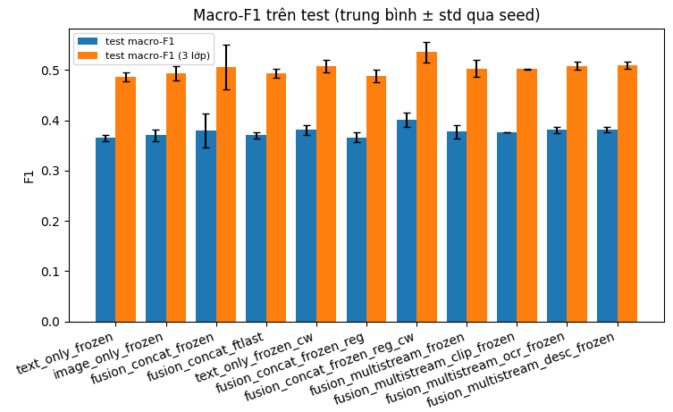
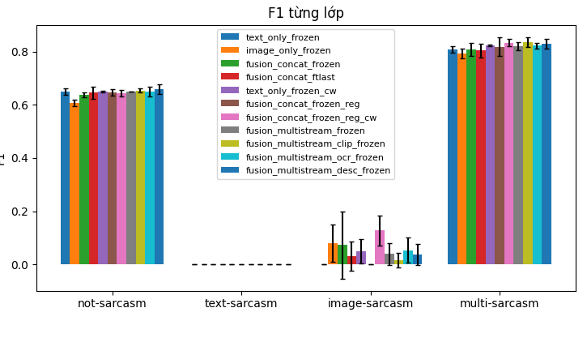

# 4.1. Multimodal fusion: concat + MLP

- **Phase:** 4, Multimodal fusion cơ bản
- **Thành viên:** Phúc, Nhi
- **Configs:** `fusion_concat_frozen.yaml`, `fusion_concat_ftlast.yaml`, `fusion_concat_frozen_reg.yaml`, `fusion_concat_frozen_reg_cw.yaml`; mốc: `text_only_frozen(_cw).yaml`, `image_only_frozen.yaml`; thêm: `fusion_multistream_*_frozen.yaml`
- **Notebook:** `notebooks/04_fusion_concat.ipynb`; plan `configs/experiments/phase4_baselines.yaml`
- **Nguồn số liệu:** `reports/results/results.md` (33 run, Kaggle, commit `1c8a749`, 02/11/2026); `reports/word/Phase 4 — Multimodal Fusion cơ bản.docx` (Phúc, Nhi: số tham số, phân tích từng mẫu, hình)
- **Tập đánh giá:** private test 1.504 mẫu; 3 seed (42, 1, 2), `split_seed=42` nên 3 seed dùng chung một tập test

---

## 1. Phương pháp

### 1.1. Concat + MLP

```
caption → PhoBERT-base → vector <s> (768) ─┐
                                           ├─► nối (1536) ─► MLP 1536 → 512 → 4
ảnh     → CLIP ViT-B/32 → pooled (768) ────┘
```

### 1.2. Các biến thể

| Config | Encoder | Nhánh fusion | Loss | Tham số train |
|---|---|---|---|---|
| `fusion_concat_frozen` | đóng băng cả hai | nối thẳng | CE | khoảng 0,79M |
| `fusion_concat_ftlast` | mở lại 2 block cuối mỗi encoder (CLIP thêm `post_layernorm`) | nối thẳng | CE | khoảng 29,1M |
| `fusion_concat_frozen_reg` | đóng băng | LayerNorm + Linear(256) mỗi nhánh; dropout 0,2 trên vector ảnh; bỏ hẳn ảnh ở 30% mẫu train (modality dropout) | CE | khoảng 0,66M |
| `fusion_concat_frozen_reg_cw` | đóng băng | như `reg` | CE + class weight `sqrt_inverse` | khoảng 0,66M |

Số tham số train (file Word Phase 4): `text_only_frozen` và `image_only_frozen` 0,40M, `fusion_concat_frozen` 0,79M, `fusion_concat_ftlast` 29,14M (28,35M ở encoder), multistream 0,92–1,85M.

**Vì sao có bản `reg`:** head đóng băng học thuộc train qua vector CLIP cố định. LayerNorm + projection cân lại độ lớn hai nhánh; dropout và modality dropout buộc head không chỉ dựa vào ảnh. Không bỏ text, vì nhánh ảnh một mình yếu.

### 1.3. Huấn luyện

| Mục | Đóng băng | `ftlast` |
|---|---|---|
| lr | head 1e-3 | encoder 2e-5, head 1e-4 (1e-3 overfit sau 2 epoch) |
| Epoch tối đa | 20 | 20 |
| Chung | batch 16, AMP, patience 3 theo **val macro-F1 4 lớp**, `image_resize: pad` | |

Mốc so sánh dùng **cùng chế độ đóng băng** (`text_only_frozen`, `image_only_frozen`), để chênh lệch đến từ việc kết hợp modality chứ không phải từ đóng băng hay fine-tune.

## 2. Kết quả trên private test

Mean ± std trên 3 seed. Macro-F1 3 lớp bỏ `text-sarcasm` (7 mẫu test).

| Config | Val macro-F1 | **Test macro-F1** | Test 3 lớp | Weighted-F1 | Accuracy | F1 not | F1 text | F1 image | F1 multi | Phút | VRAM |
|---|---|---|---|---|---|---|---|---|---|---|---|
| `text_only_frozen` | 0.373 ± 0.006 | 0.365 ± 0.006 | 0.487 ± 0.008 | 0.736 | 0.741 | 0.651 | 0.000 | 0.000 | 0.809 | 3,0 | 0,89 |
| `text_only_frozen_cw` | 0.390 ± 0.028 | 0.381 ± 0.010 | 0.508 ± 0.013 | 0.746 | 0.752 | 0.650 | 0.000 | 0.050 | 0.824 | 3,3 | 0,89 |
| `image_only_frozen` | 0.366 ± 0.011 | 0.370 ± 0.011 | 0.494 ± 0.015 | 0.714 | 0.715 | 0.608 | 0.000 | 0.080 | 0.793 | 18,9 | 0,48 |
| `fusion_concat_frozen` | 0.378 ± 0.013 | 0.380 ± 0.033 | 0.506 ± 0.044 | 0.733 | 0.736 | 0.637 | 0.000 | 0.073 | 0.809 | 20,8 | 1,26 |
| `fusion_concat_ftlast` | 0.379 ± 0.009 | 0.370 ± 0.007 | 0.494 ± 0.009 | 0.732 | 0.734 | 0.646 | 0.000 | 0.032 | 0.804 | 19,9 | 1,51 |
| `fusion_concat_frozen_reg` | 0.381 ± 0.013 | 0.366 ± 0.009 | 0.488 ± 0.013 | 0.741 | 0.750 | 0.647 | 0.000 | 0.000 | 0.819 | 18,1 | 1,26 |
| **`fusion_concat_frozen_reg_cw`** | **0.399 ± 0.007** | **0.402 ± 0.015** | **0.535 ± 0.020** | 0.753 | 0.755 | 0.644 | 0.000 | **0.128** | 0.834 | 13,8 | 1,26 |
| `fusion_multistream_frozen` | 0.370 ± 0.001 | 0.377 ± 0.013 | 0.503 ± 0.017 | 0.743 | 0.750 | 0.650 | 0.000 | 0.039 | 0.820 | 8,0 | 0,91 |
| `fusion_multistream_clip_frozen` | 0.383 ± 0.023 | 0.376 ± 0.001 | 0.502 ± 0.001 | 0.755 | 0.768 | 0.653 | 0.000 | 0.016 | 0.836 | 16,8 | 1,27 |
| `fusion_multistream_ocr_frozen` | 0.385 ± 0.015 | 0.381 ± 0.006 | 0.508 ± 0.008 | 0.745 | 0.748 | 0.650 | 0.000 | 0.053 | 0.822 | 8,7 | 0,90 |
| `fusion_multistream_desc_frozen` | 0.383 ± 0.005 | 0.382 ± 0.005 | 0.509 ± 0.007 | 0.753 | 0.761 | 0.659 | 0.000 | 0.038 | 0.830 | 7,4 | 0,90 |

`fusion_multistream_clip_frozen` = caption + OCR + mô tả + vector CLIP. Phân tích các biến thể multistream không có CLIP ở Phase 3.2.





Test macro-F1 từng seed (42, 1, 2):

| Config | s42 | s1 | s2 |
|---|---|---|---|
| `fusion_concat_frozen` | 0.3531 | 0.4169 | 0.3689 |
| `fusion_concat_ftlast` | 0.3739 | 0.3629 | 0.3746 |
| `fusion_concat_frozen_reg` | 0.3735 | 0.3556 | 0.3700 |
| `fusion_concat_frozen_reg_cw` | 0.4163 | 0.3869 | 0.4013 |

## 3. Phân tích

### 3.1. Fusion so với đơn modality

| So sánh (test, 3 lớp) | Chênh lệch |
|---|---|
| `fusion_concat_frozen` − max(text, image) đóng băng | 0.506 − 0.494 = +0,012, nhưng std của concat là 0,044 |
| `fusion_concat_frozen_reg_cw` − `text_only_frozen_cw` | 0.535 − 0.508 = **+0,027** (khoảng 1,3–2 std) |

- **Khi cùng loss CE, thêm ảnh giúp rất ít.** Concat đóng băng (0.380 ± 0.033) chỉ hơn text-only (0.365) và image-only (0.370) trong phạm vi nhiễu: một seed đạt 0.417, hai seed còn lại 0.353 và 0.369.
- **Text-only có class weight (0.381) ngang mọi biến thể fusion không có class weight** (0.366–0.380).
- **Chỉ `reg_cw` hơn text-only cùng class weight một cách đáng kể.** Phần tăng đến chủ yếu từ `image-sarcasm` (F1 0,128 so với 0,050) và `multi-sarcasm` (0,834 so với 0,824).

### 3.2. Phân tích từng mẫu

Trên 1.504 mẫu test, trung bình 3 seed (cell "giúp/nhiễu" của notebook 04, file Word Phase 4). "Giúp" = fusion đúng khi mốc sai; "nhiễu" = fusion sai khi mốc đúng.

| Mốc → Fusion | Giúp | Nhiễu | Net | `image` đúng (mốc → fusion) |
|---|---:|---:|---:|---|
| `text_only_frozen` → `fusion_concat_frozen` | 123,0 | 131,3 | **−8,3** | 0,0 → 3,3 |
| `text_only_frozen` → `fusion_concat_ftlast` | 119,7 | 130,0 | −10,3 | – |
| `text_only_frozen` → `fusion_concat_frozen_reg` | 121,3 | 108,0 | +13,3 | – |
| `text_only_frozen_cw` → `fusion_concat_frozen_reg_cw` | 112,0 | 108,0 | +4,0 | 1,3 → 6,3 |
| `text_only_frozen` → `fusion_multistream_frozen` | 94,0 | 81,3 | +12,7 | – |
| `fusion_multistream_frozen` → `_clip_frozen` | 111,0 | 83,3 | +27,7 | – |
| `fusion_multistream_frozen` → `_ocr_frozen` | 108,0 | 97,3 | +10,7 | – |
| `fusion_multistream_frozen` → `_desc_frozen` | 96,7 | 67,0 | +29,7 | – |

- Thêm nhánh ảnh sửa được hơn 100 mẫu nhưng cũng làm hỏng gần chừng đó. Với concat thô, net −8: nhánh ảnh chủ yếu xáo trộn quyết định của head, không phải tín hiệu một chiều. Kết quả trùng với Phase 10 trên val (C sửa 94 lỗi của T, làm hỏng 80 mẫu T đúng).
- Khoảng 250 mẫu (khoảng 17% test) là nơi các mô hình khác nhau; phần còn lại mốc và fusion trả lời giống nhau.
- Cross-attention (Phase 5) cho net dương lớn hơn nhiều (+55,7 so với text_only), xem `5_1_cross_attention.md`.

### 3.3. Đóng băng so với mở 2 block cuối

`ftlast` (0.370 ± 0.007) **không hơn** bản đóng băng (0.380 ± 0.033) dù train gấp khoảng 37 lần số tham số và tốn thêm 0,25 GB VRAM. Với dữ liệu nhỏ và mất cân bằng, mở thêm encoder làm overfit nhanh hơn là học thêm được tín hiệu.

### 3.4. Regularize và class weight

- `reg` một mình không giúp (0.366, F1 image về 0): dropout ảnh làm head dựa vào caption nhiều hơn.
- `reg` + class weight là cấu hình tốt nhất: **class weight là yếu tố tác động lớn nhất trong Phase 4** (+3,6 điểm 4 lớp, +4,7 điểm 3 lớp trên concat `reg`; +1,6 / +2,1 điểm trên text-only).

### 3.5. So với mốc

- `fusion_concat_frozen_reg_cw` đạt 0.402 ± 0.015, nằm trong 1 std so với mốc 0,41 của Vu et al. (2025).
- **Không config nào dự đoán được `text-sarcasm`** (F1 = 0 ở cả 33 run).

### 3.6. Kiểm chứng lại ở Phase 10

Phase 10 chạy lại cùng kiến trúc (`fusion_concat_frozen_reg`, gọi là C) với thiết lập thống nhất (chọn checkpoint theo val macro-F1 bỏ `text-sarcasm`, GPU server, finalists chốt trước khi chấm private test):

| Mô hình | Private test macro-F1 |
|---|---|
| C (CE) | 0.369 ± 0.011 |
| C + B1 (class weight `sqrt_inverse`) | 0.380 ± 0.007 |
| T + B1 (text-only + class weight) | 0.366 ± 0.014 |

Hướng của kết quả giữ nguyên (C + B1 > C > T), nhưng mức điểm thấp hơn Phase 4 khoảng 2 điểm, và không contrast nào có khoảng tin cậy loại được 0. Chênh lệch giữa 0.402 và 0.380 có thể đến từ cách chọn checkpoint (val 4 lớp so với val 3 lớp), môi trường (Kaggle so với GPU server) và nhiễu giữa các seed (std 0,015 và 0,007); hai lượt không được thiết kế để so trực tiếp.

## 4. Kết luận

1. **Mô hình tốt nhất Phase 4 (chọn theo val):** `fusion_concat_frozen_reg_cw`, private test macro-F1 **0.402 ± 0.015** (3 lớp 0.535 ± 0.020).
2. Thêm ảnh bằng concat giúp ít khi so cùng loss; phần lớn tín hiệu nằm ở caption.
3. Class weight tác động lớn hơn mọi thay đổi kiến trúc.
4. Fine-tune nhẹ 2 block cuối không giúp.
5. Kết quả được kiểm chứng lại ở Phase 10 với mức thấp hơn (0.380 ± 0.007): xem `10_6_exp_e_targeted_improvement.md`.

## 5. Hạn chế

- Chọn checkpoint theo val macro-F1 4 lớp, trong khi val chỉ có 1 mẫu `text-sarcasm`.
- Private test được chấm cho mọi run để báo cáo, nhưng không dùng để chọn checkpoint hay config: chọn theo val macro-F1 4 lớp cũng cho ra `fusion_concat_frozen_reg_cw` (val 0.399, cao nhất trong 11 config; thứ hai là `text_only_frozen_cw` 0.390).
- Ma trận nhầm lẫn của 33 run chưa đưa vào repo; output notebook 04 trong repo (`output/04_*`) là bản chạy đầu trên split ngẫu nhiên, không dùng được.
- Cột "Phút" chỉ so được giữa các run cùng chế độ chạy: trên Kaggle hai run chạy song song dùng chung 4 CPU để đọc ảnh, nên các config có ảnh (18–21 phút) có thể chậm hơn khi chạy một mình.
