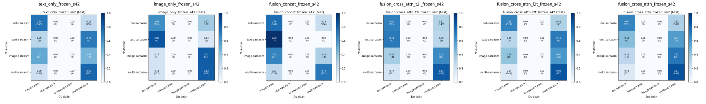
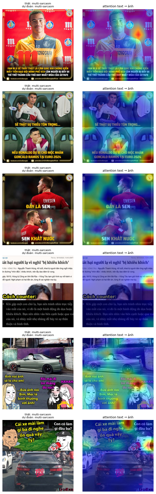

# 5.1. Cross-attention fusion

- **Phase:** 5, Cross-attention fusion
- **Thành viên:** Mai
- **Code:** `src/vimmsd/models/fusion.py` (`CrossAttentionBlock`, `CrossAttentionFusion`), PR #18 (`feat/phase5-cross-attention`, commit `62012c8`, `16c9929`)
- **Configs:** `fusion_cross_attn_t2i_frozen.yaml` (5.3), `fusion_cross_attn_i2t_frozen.yaml` (5.4), `fusion_cross_attn_frozen.yaml` (5.5, cả hai chiều); mốc: `text_only_frozen`, `image_only_frozen`, `fusion_concat_frozen`
- **Notebook:** `notebooks/05_fusion_cross_attention.ipynb`
- **Nguồn số liệu:** `reports/word/Phase 5 — Cross-attention Fusion.docx` (Mai). Kaggle 2× T4, commit `feb1589` (nằm trên fork của Mai, chưa có trong repo nhóm), 6 config × 3 seed = 18 run, 128 test của repo pass
- **Tập đánh giá:** private test 1.504 mẫu (not 458, text 7, image 40, multi 999); val = public test 1.413 mẫu dùng để chọn checkpoint

---

## 1. Phương pháp

Concat (Phase 4) chỉ nối hai vector tổng (`<s>` của PhoBERT, pooled của CLIP), nên head không thấy được *chỗ nào* trong ảnh khớp hay lệch với *từ nào* trong caption. Cross-attention cho từng token của modality này nhìn vào từng token của modality kia.

### 1.1. Đầu vào

- Text: toàn bộ token PhoBERT (`vinai/phobert-base`, tối đa 256), kèm mask padding.
- Ảnh: 50 token CLIP ViT-B/32 (1 CLS + 49 patch, lưới 7×7).
- Cả hai encoder **đóng băng**, cùng chế độ với `fusion_concat_frozen`, để chênh lệch đến từ cách kết hợp chứ không từ fine-tune.

### 1.2. Kiến trúc

```
token text  ─► Linear(768 → 512) ─► t ─┐
                                        ├─► khối cross-attention theo direction ─► pool ─► [t; i; t·i; |t − i|] (2048) ─► MLP 2048 → 512 → 4
patch ảnh   ─► Linear(768 → 512) ─► i ─┘
```

Mỗi khối `CrossAttentionBlock`: multi-head attention (8 head, hidden 512, dropout 0,1) → residual + LayerNorm → FFN (512 → 2048 → 512, GELU) → residual + LayerNorm. 1 lớp.

| Task | `direction` | Query | Key/Value | Config |
|---|---|---|---|---|
| 5.3 | `text_to_image` | token text | patch ảnh | `fusion_cross_attn_t2i_frozen` |
| 5.4 | `image_to_text` | patch ảnh | token text (có mask padding) | `fusion_cross_attn_i2t_frozen` |
| 5.5 | `both` | hai khối chạy song song | | `fusion_cross_attn_frozen` |

- Chiều không chạy thì modality đó chỉ qua phép chiếu tuyến tính, nên `out_dim` = 2048 ở cả ba chế độ.
- Pool: text lấy trung bình có mask, ảnh lấy trung bình 50 token.
- `t·i` và `|t − i|` biểu diễn trực tiếp mức khớp/lệch giữa hai modality.
- Attention weight của lớp cuối lưu ở `self.last_attn` để vẽ attention map (mục 3.6, Phase 9.2).

### 1.3. Huấn luyện

Giữ nguyên chế độ của Phase 4 để so công bằng:

| Mục | Giá trị |
|---|---|
| Split | train 10.805, val = public test 1.413, test = private test 1.504; không thiếu ảnh nào |
| Seed | 42, 1, 2 |
| Loss | CE, **không class weight**, sampler random |
| Tối ưu | batch 16, `lr_head` 1e-3, weight decay 0,01, AMP fp16, tối đa 20 epoch, patience 3 theo val macro-F1 4 lớp |
| Phần cứng | Kaggle 2× T4, mỗi GPU một run |

### 1.4. Số tham số

| Config | Vai trò | Tham số train (M) | Tổng (M) |
|---|---|---:|---:|
| `text_only_frozen` | mốc | 0,40 | 135,39 |
| `image_only_frozen` | mốc | 0,40 | 87,85 |
| `fusion_concat_frozen` | baseline concat (Phase 4) | 0,79 | 223,24 |
| `fusion_cross_attn_t2i_frozen` | 5.3 | 4,99 | 227,45 |
| `fusion_cross_attn_i2t_frozen` | 5.4 | 4,99 | 227,45 |
| `fusion_cross_attn_frozen` | 5.5 | 8,14 | 230,60 |

Head cross-attention có số tham số train gấp khoảng 6 lần (một chiều) đến 10 lần (hai chiều) so với concat. Vì vậy mọi chênh lệch dưới đây không tách được khỏi tác động của dung lượng head.

## 2. Kết quả trên private test

### 2.1. Tổng hợp (mean ± std, 3 seed)

| Config | Val macro-F1 | **Test macro-F1** | Test 3 lớp | Weighted-F1 | Accuracy | F1 not | F1 text | F1 image | F1 multi | Phút | VRAM (GB) |
|---|---|---|---|---|---|---|---|---|---|---|---|
| `text_only_frozen` | 0.373 ± 0.006 | 0.365 ± 0.006 | 0.487 ± 0.008 | 0.736 ± 0.012 | 0.741 ± 0.013 | 0.651 | 0.000 | 0.000 | 0.809 | 2,9 | 0,89 |
| `image_only_frozen` | 0.366 ± 0.016 | 0.370 ± 0.011 | 0.494 ± 0.015 | 0.714 ± 0.013 | 0.715 ± 0.021 | 0.608 | 0.000 | 0.080 | 0.793 | 21,2 | 0,48 |
| `fusion_concat_frozen` | 0.378 ± 0.013 | 0.380 ± 0.033 | 0.506 ± 0.044 | 0.733 ± 0.019 | 0.736 ± 0.024 | 0.637 | 0.000 | 0.073 | 0.809 | 21,1 | 1,26 |
| cross-attn t2i (5.3) | 0.367 ± 0.004 | 0.372 ± 0.002 | 0.497 ± 0.002 | 0.752 ± 0.004 | 0.763 ± 0.007 | 0.659 | 0.000 | 0.000 | 0.831 | 13,8 | 1,31 |
| cross-attn i2t (5.4) | 0.372 ± 0.007 | 0.367 ± 0.012 | 0.489 ± 0.016 | 0.739 ± 0.025 | 0.745 ± 0.030 | 0.653 | 0.000 | 0.000 | 0.813 | 16,4 | 1,31 |
| **cross-attn 2 chiều (5.5)** | 0.376 ± 0.002 | **0.380 ± 0.001** | **0.507 ± 0.002** | **0.766 ± 0.003** | **0.778 ± 0.004** | **0.676** | 0.000 | 0.000 | **0.844** | 11,8 | 1,36 |

Ba mốc được chạy lại trong cùng notebook; test macro-F1 và F1 từng lớp trùng với Phase 4 (`4_1_fusion_concat.md`), chỉ thời gian và std val của `image_only_frozen` khác một chút.

### 2.2. Từng seed và chênh lệch

Test macro-F1:

| Seed | text_only | image_only | concat | t2i | i2t | 2 chiều | 2 chiều − text | 2 chiều − concat |
|---|---|---|---|---|---|---|---|---|
| 42 | 0.3712 | 0.3576 | 0.3531 | 0.3708 | 0.3776 | 0.3812 | +0.010 | +0.028 |
| 1 | 0.3650 | 0.3758 | 0.4169 | 0.3733 | 0.3533 | 0.3784 | +0.013 | −0.039 |
| 2 | 0.3588 | 0.3774 | 0.3689 | 0.3734 | 0.3686 | 0.3803 | +0.022 | +0.011 |
| mean | 0.365 | 0.370 | 0.380 | 0.372 | 0.367 | 0.380 | **+0.015 ± 0.006** | **+0.000 ± 0.035** |

Các chênh lệch khác (seed 42 / 1 / 2):

| Contrast | Từng seed | Mean |
|---|---|---|
| t2i − text_only | −0.000 / +0.008 / +0.015 | +0.007 ± 0.008 |
| i2t − text_only | +0.006 / −0.012 / +0.010 | +0.002 ± 0.012 |
| 2 chiều − t2i | +0.010 / +0.005 / +0.007 | +0.007 |
| 2 chiều − i2t | +0.004 / +0.025 / +0.012 | +0.014 |

### 2.3. Phân tích từng mẫu

Trên 1.504 mẫu test, trung bình 3 seed. "Giúp" = fusion đúng khi mốc sai; "nhiễu" = fusion sai khi mốc đúng.

| Mốc → Fusion | Giúp | Nhiễu | Net | Giúp ở multi / not |
|---|---:|---:|---:|---|
| text_only → t2i | 120,0 | 87,3 | +32,7 | 101,7 / 18,3 |
| text_only → i2t | 93,7 | 87,3 | +6,4 | 71,7 / 22,0 |
| text_only → 2 chiều | 111,0 | 55,3 | **+55,7** | 98,3 / 12,7 |
| concat → t2i | 147,7 | 106,7 | +41,0 | 106,7 / 41,0 |
| concat → i2t | 148,0 | 133,3 | +14,7 | 97,7 / 50,3 |
| concat → 2 chiều | 152,7 | 88,7 | **+64,0** | 115,7 / 37,0 |

Tham chiếu: concat so với text_only ở Phase 4 có net −8,3.

### 2.4. Ma trận nhầm lẫn (seed 42)



*Theo thứ tự: text_only, image_only, concat, t2i, i2t, 2 chiều; chuẩn hoá theo hàng, số mẫu trong ngoặc.*

Số mẫu bị dự đoán thành `not` / `multi`, theo nhãn thật:

| Nhãn thật (mẫu) | text_only | concat | t2i | i2t | 2 chiều |
|---|---|---|---|---|---|
| not (458) | 340 / 118 | 349 / 106 | 315 / 143 | 311 / 147 | 309 / 149 |
| text (7) | 2 / 5 | 7 / 0 | 5 / 2 | 2 / 5 | 3 / 4 |
| image (40) | 21 / 19 | 27 / 13 | 14 / 26 | 16 / 24 | 11 / 29 |
| multi (999) | 204 / 795 | 272 / 723 | 171 / 828 | 144 / 855 | 131 / 868 |

Ngoài concat (7 dự đoán `image`, đều sai: 3 từ `not`, 4 từ `multi`), không mô hình nào ở seed 42 dự đoán `text` hay `image`.

| Recall (seed 42) | text_only | concat | 2 chiều |
|---|---|---|---|
| multi | 0,80 | 0,72 | **0,87** |
| not | 0,74 | 0,76 | 0,67 |
| `image` được xếp vào lớp châm biếm (`multi`) | 19/40 | 13/40 | 29/40 |

`image_only_frozen` xếp 33/40 mẫu `image` vào `multi`.

### 2.5. Attention text → ảnh (định tính)



*`fusion_cross_attn_frozen`, seed 42, 6 mẫu đầu tiên thuộc `image`/`multi` trong private test. Cả 6 mẫu đều có nhãn `multi` và được dự đoán đúng.*

- Vùng attention cao không theo một loại nội dung cố định. Mẫu 1–2 tập trung vào nhân vật (vai, mặt), mẫu 4–5 vào một vùng chữ, mẫu 3 và 6 phân tán với cường độ thấp.
- Các vùng chữ lớn trong ảnh (mẫu 1, 2, 6) không phải lúc nào cũng nhận attention cao, nên chưa có bằng chứng mô hình khai thác chữ trong ảnh.
- Năm trong sáu ảnh có logo/watermark của trang nguồn (`trollbongda`, `trollxe`). Đây là cùng loại tín hiệu nguồn đã thấy ở Phase 9–10; trên 6 mẫu này attention không tập trung rõ vào logo, nhưng 6 mẫu không đủ để loại trừ.

Chi tiết và giới hạn: `9_2_interpretability.md`.

## 3. Trả lời câu hỏi của phase

**5.3, text → ảnh có tốt hơn concat không?** Không trên macro-F1 (0.372 so với 0.380, std concat 0,033). Tốt hơn trên accuracy (0,763 so với 0,736) và F1 `multi` (0,831 so với 0,809), và ổn định hơn nhiều (std 0,002).

**5.4, ảnh → text có tốt hơn concat không?** Không. 0.367 ± 0.012, gần bằng text_only (Δ +0,002, đổi dấu giữa các seed).

**5.5, hai chiều có vượt concat không, và thắng ở đâu?**

- **Macro-F1 bằng concat:** 0.380 so với 0.380, Δ +0,000 ± 0,035, đổi dấu giữa các seed. Con số 0.380 của concat được kéo lên nhờ seed 1 (0,417); hai seed còn lại concat chỉ 0,353 và 0,369.
- **Ổn định hơn hẳn:** std 0,001 so với 0,033.
- **Thắng text_only ở cả 3 seed** (+0,010 / +0,013 / +0,022), nhưng biên độ nhỏ. Thắng cả t2i và i2t ở 3/3 seed.
- **Thắng ở hai lớp lớn:** accuracy +0,042, weighted-F1 +0,033, F1 `multi` 0,844, F1 `not` 0,676 (cao nhất). Phân tích từng mẫu cho net +55,7 so với text_only và +64,0 so với concat; phần lớn mẫu được sửa là `multi`.
- **Đổi lại, mô hình nghiêng về `multi`:** recall `not` giảm còn 0,67 (149/458 mẫu `not` bị đoán `multi`). Ở lớp `not`, so với text_only, bản hai chiều làm hỏng 36,7 mẫu và chỉ sửa 12,7 mẫu.

**Chiều nào hơn?** Hai chiều đơn lẻ chênh nhau dưới 0,005 macro-F1, nhỏ hơn std của chính chúng. Bằng chứng nghiêng về text → ảnh chỉ đến từ accuracy và F1 `multi`.

## 4. Vì sao macro-F1 không đổi

Cả 9/9 run cross-attention có F1 `text` = F1 `image` = 0. Khi đó macro-F1 chỉ còn (F1 not + F1 multi) / 4; với bản hai chiều là (0,676 + 0,844) / 4 = 0,380. Cải thiện ở hai lớp lớn tăng accuracy +0,042 nhưng chỉ đổi được macro-F1 rất ít.

Concat đôi khi bắt được `image-sarcasm` (F1 0,073 ± 0,127: một seed có, các seed khác bằng 0). Cross-attention thì không lần nào: với `image`, nó nhận ra *có* châm biếm (29/40 mẫu xếp vào `multi`) nhưng không nhận ra châm biếm *nằm ở ảnh*. Đây cùng là nút thắt đã thấy ở Phase 4 và Phase 10: mô hình chưa học được hai lớp hiếm, nên câu hỏi "fusion có giúp không" bị che khuất.

## 5. Kết luận

1. **Cross-attention hai chiều không vượt concat về macro-F1** (0.380 so với 0.380). Nó ổn định hơn (std 0,001 so với 0,033) và tốt hơn ở accuracy, weighted-F1, F1 `multi` (0,778 / 0,766 / 0,844 so với 0,736 / 0,733 / 0,809).
2. Một chiều đơn lẻ (0.372, 0.367) không phân biệt được với text_only (0.365). Bản hai chiều thắng cả hai bản một chiều ở 3/3 seed.
3. **Cross-attention không giải quyết hai lớp hiếm:** F1 `text` và `image` bằng 0 ở mọi run.
4. Cấu hình tốt nhất Phase 4 (`fusion_concat_frozen_reg_cw`, 0.402 ± 0.015) và benchmark chốt trước của Phase 10 (C + B1, 0.380 ± 0.007) dùng class weight, còn cross-attention ở đây dùng CE thuần, nên không so trực tiếp được.

## 6. Hạn chế

- CE không class weight. Bước tiếp theo hợp lý: chạy cross-attention với class weight `sqrt_inverse` (B1, Phase 8) để xem có cứu được `image-sarcasm` không.
- Head lớn hơn concat 6–10 lần; chưa có ablation tách tác động của dung lượng khỏi cơ chế attention (ví dụ concat với MLP lớn tương đương).
- Val chỉ có 1 mẫu `text` và 28 mẫu `image`; chọn checkpoint theo val macro-F1 4 lớp nên nhiễu.
- Chỉ 3 seed; chênh lệch dưới khoảng 0,01 macro-F1 không đủ để kết luận. Chưa có kiểm định paired bootstrap như Phase 10.
- Chưa lưu log từng epoch, nên chưa có đường cong huấn luyện.
- Ma trận nhầm lẫn chỉ ở seed 42.
- Attention map chỉ có 6 mẫu, đều dự đoán đúng, đều nhãn `multi`; chưa có mẫu sai hay mẫu `image-sarcasm`, chưa có chiều ảnh → text, chưa định lượng.
- Commit `feb1589` chưa có trong repo nhóm; cần merge để tái lập.
