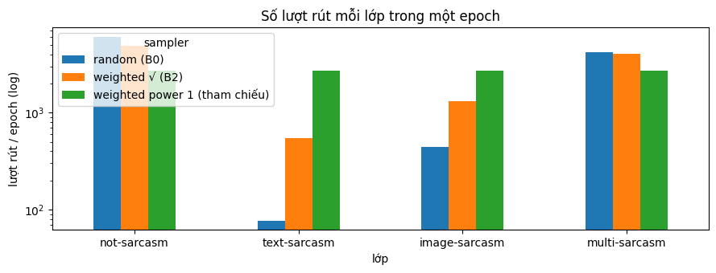
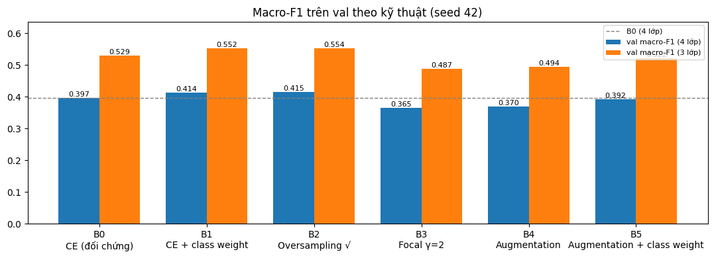
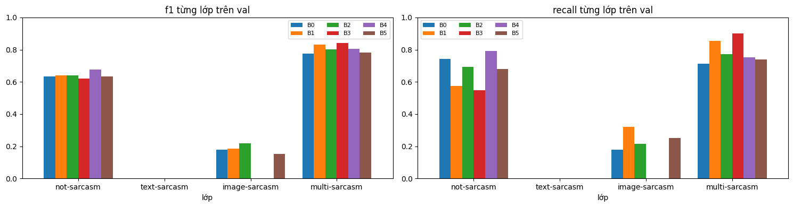
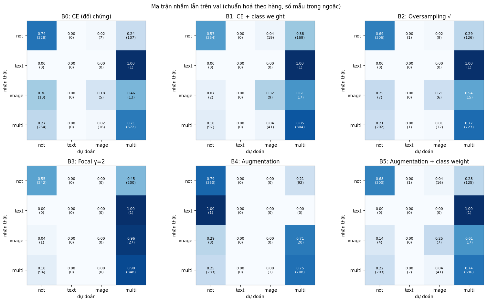
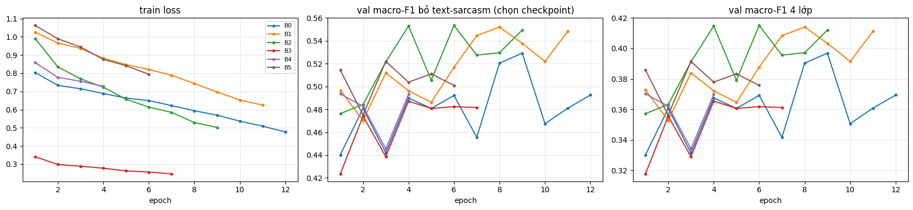

# 8.1. Xử lý mất cân bằng dữ liệu

- **Phase:** 8, Xử lý mất cân bằng dữ liệu
- **Thành viên:** Phúc, Nhi (class weighting, focal loss), Mai (oversampling, augmentation text)
- **Configs:** backbone `fusion_concat_frozen_reg.yaml` (C); `_cw` (B1), `_oversample` (B2), `_focal` (B3), `_aug` (B4), `_aug_cw` (B5); plan `configs/experiments/empirical_imbalance_screen.yaml`
- **Code:** `src/vimmsd/training/losses.py` (class weight, focal), `data.sampler=weighted/power`, `scripts/augment_captions.py`, `src/vimmsd/data/augmentation.py`
- **Notebook:** `notebooks/09_imbalance.ipynb` (Kaggle T4 x2, commit `1e86ff3`; B0/B1/B3 dùng lại output notebook `phase-9-task-1-2`, commit `7a04f25`). Trong code, phase này mang tên "Phase 9 / Experiment C".
- **Nguồn số liệu:** `reports/word/Phase9_Imbalance.docx` (bản screening của Phúc, Nhi, Mai, 15/11/2026), output của notebook 09, `reports/results/results.md`, `reports/results/empirical_phase2.md` §3, `empirical_phase3.md`, `empirical_analysis.md` §7
- **Tập đánh giá:** mục 3 và 4 trên **val** (lựa chọn kỹ thuật, không chấm private test theo giao thức); mục 5 trên **private test** (kỹ thuật đã chọn, chấm một lần)

---

## 1. Vấn đề

Train: not 6.062 · text 77 · image 442 · multi 4.224 (lệch 78 lần). Không mô hình nào ở Phase 3–4 dự đoán được `text-sarcasm`; F1 `image-sarcasm` gần 0. Phase này so sánh các kỹ thuật xử lý mất cân bằng trên **cùng một backbone** và chọn kỹ thuật tốt nhất theo macro-F1.

## 2. Các kỹ thuật

Backbone C = `fusion_concat_frozen_reg` (PhoBERT + CLIP đóng băng, concat có regularize, Phase 4).

| ID | Kỹ thuật | Chi tiết |
|---|---|---|
| B0 | CE, lấy mẫu tự nhiên | đối chứng |
| B1 | CE + class weight `sqrt_inverse` | trọng số lớp c ∝ 1/√n_c |
| B2 | CE + oversampling √ nghịch đảo tần suất | mẫu lớp c được rút với trọng số n_c^−0,5, nên tỉ lệ lớp trong epoch ∝ √n_c. Nhẹ tay hơn cân bằng hẳn |
| B3 | Focal loss γ = 2 | không class weight |
| B4 | Augmentation caption lớp hiếm + CE | back-translation vi → en → vi (`vinai/vinai-translate-vi2en-v2`, `en2vi-v2`), ảnh giữ nguyên |
| B5 | Augmentation + class weight `sqrt_inverse` | tách tác dụng của augmentation khi đã có class weight |

**Ngân sách bằng nhau:** mọi kỹ thuật rút cùng 10.805 mẫu mỗi epoch (cùng số bước cập nhật); bản augmentation không làm epoch dài thêm.

Số lượt rút mỗi lớp trong một epoch (kỳ vọng):

| Lớp | B0 random | B2 √ | Cân bằng hẳn (tham chiếu, không chạy) | Lặp mỗi mẫu/epoch ở B2 |
|---|---:|---:|---:|---:|
| not | 6.062 | 4.873 | 2.701 | 0,8 |
| text | 77 | 549 | 2.701 | **7,1** |
| image | 442 | 1.316 | 2.701 | 3,0 |
| multi | 4.224 | 4.067 | 2.701 | 1,0 |

Cân bằng hẳn sẽ lặp mỗi mẫu `text-sarcasm` khoảng 35 lần/epoch, nên B2 dùng căn bậc hai. Cái giá: mỗi epoch B2 chỉ thấy khoảng 3.349/6.062 mẫu `not` khác nhau (55%) và khoảng 62% mẫu `multi`.

**Augmentation (B4/B5):** 519 mẫu gốc (442 image, 77 text), 2 bản/mẫu.

| Lớp | Bản sinh | Lọc tự động giữ | Dùng để train | Tỉ lệ mẫu gốc có bản dùng |
|---|---:|---:|---:|---:|
| image-sarcasm | 884 | 477 | 279 | 63,1% |
| text-sarcasm | 154 | 87 | 47 | 61,0% |

474 bản bị loại, lý do (một bản có thể nhiều lý do): trùng caption khác trong train 213, độ dài lệch 120, đổi con số 98, gần trùng gốc 86, rỗng 50, lặp từ 4. Sau augmentation train có 11.131 mẫu (`text` 77 → 124, `image` 442 → 721); B4/B5 rút ngẫu nhiên 10.805 mẫu mỗi epoch nên bỏ qua khoảng 2,9% mẫu mỗi epoch. Class weight của B5 tính trên tập đã augment.

Luật lọc tự động: bỏ caption gốc < 3 hoặc > 150 từ, bản gần trùng gốc (giống > 0,9), độ dài lệch ngoài 0,6–1,6 lần, đổi con số, thêm từ chỉ nhãn ("mỉa mai", "sarcasm"), lặp từ, hoặc trùng caption khác trong train. Mỗi mẫu gốc giữ tối đa 1 bản. **Không có người duyệt** (cột duyệt = 0).

Ví dụ bản giữ lại cho thấy rủi ro: "Lưỡi không xương mà lại" → "Lưỡi không có xương." (mất ý), "Nhà ngọt\n-kem" → "Ngọt -cream Nhà", "Mot cai ket co hau\nmon." → "Mot cai ket co hau mon (bằng tiếng Anh)." Back-translation thường làm mất chơi chữ.

Lưu ý: lần chạy lưu trong notebook (commit `1e86ff3`) dùng **luật lọc cũ**: chưa lọc caption gốc quá ngắn/dài, độ giống của caption dài bị tính sai (difflib autojunk), và ưu tiên bản *khác* gốc nhất. Commit `973fcb0` đã sửa (ưu tiên bản sát nghĩa nhất) nhưng B4/B5 chưa được chạy lại.

## 3. Kết quả screening trên val (Kaggle, seed 42)

Split chính thức, train gốc (chưa lọc nhiễu), chọn checkpoint theo val macro-F1 bỏ `text-sarcasm`, không chấm private test.

| ID | Kỹ thuật | **Val macro-F1 (4 lớp)** | Val 3 lớp | Weighted-F1 | Accuracy | Δ so với B0 |
|---|---|---|---|---|---|---|
| B0 | CE | 0.3969 | 0.5292 | 0.7184 | 0.7113 | 0 |
| B1 | Class weight | 0.4141 | 0.5521 | 0.7581 | 0.7551 | +0.0172 |
| **B2** | Oversampling √ | **0.4151** | **0.5535** | 0.7396 | 0.7353 | **+0.0182** |
| B3 | Focal γ = 2 | 0.3654 | 0.4872 | 0.7546 | 0.7714 | −0.0315 |
| B4 | Augmentation | 0.3702 | 0.4935 | 0.7475 | 0.7488 | −0.0268 |
| B5 | Augmentation + class weight | 0.3915 | 0.5220 | 0.7218 | 0.7098 | −0.0054 |

Từng lớp trên val (`image-sarcasm` 28 mẫu: 1 mẫu ≈ 0,036 recall; `text-sarcasm` 1 mẫu, F1 = 0 ở mọi kỹ thuật):

| ID | P not | R not | F1 not | P image | R image | F1 image | P multi | R multi | F1 multi |
|---|---|---|---|---|---|---|---|---|---|
| B0 | 0.554 | 0.742 | 0.634 | 0.179 | 0.179 | 0.179 | 0.847 | 0.713 | 0.775 |
| B1 | 0.720 | 0.575 | 0.639 | 0.130 | **0.321** | 0.186 | 0.811 | **0.854** | **0.832** |
| B2 | 0.594 | 0.692 | 0.640 | **0.222** | 0.214 | **0.218** | 0.837 | 0.772 | 0.803 |
| B3 | 0.718 | 0.548 | 0.621 | 0.000 | 0.000 | 0.000 | 0.788 | 0.900 | 0.840 |
| B4 | 0.591 | 0.792 | 0.677 | 0.000 | 0.000 | 0.000 | 0.863 | 0.752 | 0.804 |
| B5 | 0.592 | 0.679 | 0.632 | 0.109 | 0.250 | 0.152 | 0.830 | 0.739 | 0.782 |

Số lần dự đoán `image-sarcasm` (đúng): B0 28 (5), B1 khoảng 69 (9), B2 27 (6), B5 64 (7), B4 1 (0), B3 0.

Điểm chọn checkpoint dao động 0,03–0,05 giữa hai epoch liền nhau (ví dụ B2: 0,5530 → 0,5056 → 0,5535 ở epoch 4–6), lớn hơn nhiều chênh lệch giữa B1 và B2. B4 có checkpoint tốt nhất ở epoch 1 và dừng ở epoch 4 (train loss còn 0,73), B5 ở epoch 3/6: hai run này gần như chưa được huấn luyện xong.

**Nhận xét:**

- **B1 và B2 là hai kỹ thuật duy nhất vượt B0**, khoảng +1,7–1,8 điểm, và gần như bằng nhau (chênh 0,001). Với 1 seed, không phân biệt được hai kỹ thuật này.
- B1 tăng recall `image-sarcasm` (0,18 → 0,32) và `multi`, đổi lại recall `not-sarcasm` giảm (0,74 → 0,57). B2 tăng precision và F1 `image-sarcasm` cao nhất.
- **Focal loss tệ nhất** (−3,2 điểm) và xoá hẳn `image-sarcasm`. Weighted-F1 và accuracy của B3 lại cao (0,755, 0,771): ví dụ rõ về bẫy của các chỉ số bị 2 lớp lớn chi phối.
- **Augmentation không giúp:** B4 kém B0 2,7 điểm, F1 `image` về 0; B5 (thêm class weight) kém chính B1 2,3 điểm. Back-translation chưa duyệt làm mất ý mỉa mai, nên thêm mẫu "lớp hiếm" thực chất là thêm nhiễu nhãn.
- **Không kỹ thuật nào nhận ra `text-sarcasm`.**

## 4. Kiểm chứng trên split nội bộ (GPU server, Phase 10 Experiment C)

Để không chọn kỹ thuật dựa trên 1 mẫu `text-sarcasm` và 28 mẫu `image-sarcasm` của val, Phase 10 screen B0–B3 trên **3 fold nội bộ của train, chia theo nhóm** caption/ảnh (`StratifiedGroupKFold`, mỗi fold ≥ 25 `text` và ≥ 147 `image`), seed 42, cố định 451 bước tối ưu mỗi epoch. Gộp dự đoán out-of-fold trên toàn bộ 10.805 mẫu train:

| ID | Pooled OOF macro-F1 | Từng fold | F1 not | F1 text (77) | F1 image (442) | P / R image | F1 multi |
|---|---|---|---|---|---|---|---|
| B0 | 0.381 | 0.346 0.387 0.400 | 0.722 | 0.000 | 0.171 | 0.30 / 0.12 | 0.633 |
| **B1** | **0.389** | 0.375 0.390 0.401 | 0.713 | 0.000 | 0.199 | 0.22 / 0.18 | 0.646 |
| B2 | 0.385 | 0.386 0.380 0.392 | 0.707 | 0.000 | 0.204 | 0.17 / 0.25 | 0.629 |
| B3 | 0.371 | 0.376 0.365 0.360 | 0.719 | 0.000 | 0.145 | 0.23 / 0.11 | 0.619 |

| Contrast | Δ | 95% CI (paired bootstrap) | Group 95% CI |
|---|---|---|---|
| B1 − B0 | +0.008 | [−0.004, +0.019] | [−0.007, +0.024] |
| B2 − B0 | +0.004 | [−0.008, +0.016] | [−0.014, +0.023] |
| B3 − B0 | −0.011 | [−0.023, +0.001] | [−0.032, +0.015] |

- Cùng thứ tự với Kaggle: B1 ≥ B2 > B0 > B3. Không contrast nào có khoảng tin cậy loại được 0.
- `text-sarcasm` vẫn F1 = 0 cho cả 77 mẫu ở mọi kỹ thuật.
- B4/B5 bản có người duyệt không được chạy trên server: 966 bản sinh cần duyệt, nhóm quyết định bỏ bước duyệt hai người.

**Chọn kỹ thuật** (luật chốt trước: chỉ chọn kỹ thuật mới nếu vượt B1; hoà thì chọn kỹ thuật đơn giản hơn): **B1, class weight `sqrt_inverse`**. B2 ngang B1 trên Kaggle val nhưng thấp hơn trên OOF, và không vượt B1 ở cả hai. File Word của nhóm (chỉ dựa trên Kaggle val, 1 seed) đề xuất đưa B2 vào bước xác nhận cùng B0, B1; bước xác nhận đó chính là screening OOF ở trên, và B2 không vượt B1.

## 5. Kết quả trên private test

### 5.1. Benchmark cuối của Phase 10 (finalists chốt trước khi chấm, 3 seed)

| Mô hình | **Test macro-F1** | Test 3 lớp | Weighted-F1 | Accuracy | F1 not | F1 image (40) | F1 multi |
|---|---|---|---|---|---|---|---|
| T (caption, CE) | 0.359 ± 0.021 | 0.478 | 0.721 | 0.726 | 0.644 | 0.000 | 0.791 |
| T + B1 | 0.366 ± 0.014 | 0.487 | 0.729 | 0.732 | 0.642 | 0.017 | 0.803 |
| C (CE) | 0.369 ± 0.011 | 0.492 | 0.733 | 0.738 | 0.641 | 0.027 | 0.809 |
| **C + B1** | **0.380 ± 0.007** | **0.507** | **0.741** | **0.746** | **0.647** | **0.057** | **0.817** |

| Contrast | Δ | Từng seed (1, 2, 42) | 95% CI | p (Holm) | Kết luận |
|---|---|---|---|---|---|
| C + B1 − C | +0.011 | +0.012 +0.015 +0.007 | [−0.002, +0.025] | 0.16 | chưa kết luận được; cùng chiều ở mọi seed, đạt mục tiêu thực tế +1 điểm |
| T + B1 − T | +0.007 | +0.015 +0.001 +0.004 | [+0.000, +0.014] | 0.14 | chưa kết luận được; dưới mục tiêu +1 điểm |

### 5.2. Bằng chứng từ Phase 4 (Kaggle, 3 seed, chọn checkpoint theo val 4 lớp)

| Cặp | Không class weight | Có class weight | Δ |
|---|---|---|---|
| Text-only đóng băng | 0.365 ± 0.006 | 0.381 ± 0.010 | +0.016 |
| Concat `reg` | 0.366 ± 0.009 | **0.402 ± 0.015** | +0.036 |

### 5.3. Nhận xét

- **Class weight cải thiện cùng chiều ở mọi nơi đo** (Kaggle val, OOF nội bộ, server val, private test, Phase 4), mức +0,7 đến +3,6 điểm. Nhưng trên benchmark cuối, chưa contrast nào loại được 0 sau hiệu chỉnh Holm.
- Trên val, B1 tăng F1 `image-sarcasm` rõ (0,146 → 0,206 ở Phase 10); **trên private test, phần tăng không đến từ lớp hiếm** (recall `image` chỉ 0,04) mà từ `multi` và `not`. Ước lượng trên val lạc quan cho lớp hiếm.
- Mức tăng trên val (+1,7 điểm cho C, +3,1 cho T) co lại còn +1,1 và +0,7 trên private test.

## 6. Kết luận

1. **Kỹ thuật được chọn: class weight `sqrt_inverse` (B1).** Mô hình tốt nhất: C + B1, private test macro-F1 0.380 ± 0.007 (Phase 10, GPU server, chọn checkpoint theo val 3 lớp); cùng kiến trúc ở Phase 4 (Kaggle, chọn checkpoint theo val 4 lớp) đạt 0.402 ± 0.015.
2. Oversampling √ (B2) ngang B1, là lựa chọn thay thế hợp lý.
3. Focal loss và augmentation back-translation chưa duyệt làm kết quả tệ hơn.
4. **Không kỹ thuật nào học được `text-sarcasm`.** Với 77 mẫu train và ranh giới nhãn không rõ, xử lý mất cân bằng ở mức loss/sampling không đủ.

## 7. Hạn chế

- Screening Kaggle chỉ 1 seed trên val; OOF nội bộ chỉ 1 seed.
- B4/B5 dùng augmentation chưa duyệt, luật lọc cũ, và chỉ chạy trên Kaggle.
- Thời gian train của B0/B1/B3 trong notebook (30,0; 26,9; 9,9 phút) khác với `results.md` (30,5; 30,0; 8,7 phút) vì hai nguồn đọc từ hai lần ghi khác nhau; không ảnh hưởng điểm số.
