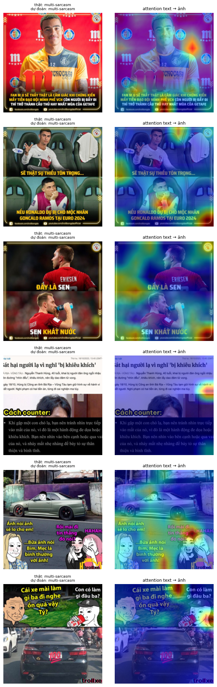

# 9.2. Interpretability

- **Phase:** 9, Shortcut learning và Interpretability
- **Thành viên:** chưa phân công trong `report_main.md`
- **Code:** `src/vimmsd/analysis/interpretability.py` (`cross_attention_maps`, `gradcam`, `overlay_heatmap`, `merge_subwords`, `words_to_html`), `src/vimmsd/analysis/shortcut_check.py` (`integrated_gradients`, `rank_words`), `scripts/diagnose_shortcuts.py`
- **Notebook:** `notebooks/05_fusion_cross_attention.ipynb` (cell attention map, Mai chạy trên Kaggle); `notebooks/06_shortcut_interpretability.ipynb` (chưa chạy)
- **Nguồn số liệu:** `reports/word/Phase 5 — Cross-attention Fusion.docx` §3.6 (attention map); `reports/results/experiment_report.md` §5.5 (D1, Integrated Gradients)
- **Tập đánh giá:** attention map trên private test (6 mẫu); Integrated Gradients trên val (public test)

---

## 1. Trạng thái so với task của `report_main.md`

| Task | Trạng thái |
|---|---|
| Vẽ attention map từ cross-attention lên ảnh gốc | **Đã làm một phần:** chiều text → ảnh của `fusion_cross_attn_frozen` (seed 42) trên 6 mẫu test (mục 2). Chưa có mẫu sai, mẫu `image-sarcasm`, hay định lượng |
| Highlight các từ được chú ý nhiều trong caption | **Đã làm bằng Integrated Gradients** trên mô hình M (`distill_flat_a`), mục 3. Bản dùng attention của cross-attention (`image_to_text`) chưa làm |
| Grad-CAM trên ảnh | Code có (`gradcam`, lấy layer cuối của vision encoder), chưa chạy |

## 2. Attention map từ cross-attention lên ảnh

### 2.1. Cách vẽ

- **Mô hình:** `fusion_cross_attn_frozen` (cross-attention hai chiều, PhoBERT + CLIP đóng băng, Phase 5), seed 42; private test macro-F1 0.380 ± 0.001 (3 seed).
- **Attention:** `CrossAttentionFusion.last_attn` của khối text → ảnh: mỗi token text có một phân bố trên 50 token ảnh. Lấy trung bình trên các head và các token text (bỏ padding), bỏ token CLS, được lưới 7×7 patch; `cross_attention_maps` phóng lưới này lên kích thước ảnh và `overlay_heatmap` phủ lên ảnh gốc.
- **Mẫu:** 6 mẫu đầu tiên của private test có nhãn `image` hoặc `multi`. Cả 6 đều là `multi` và đều được dự đoán đúng.

### 2.2. Kết quả

*Trái: ảnh gốc kèm nhãn thật và dự đoán. Phải: attention text → ảnh.*

| Mẫu | Nội dung ảnh | Vùng attention cao |
|---|---|---|
| 1 | cầu thủ, chữ lớn ở dưới, logo trang nguồn | thân/vai nhân vật |
| 2 | hai khung cầu thủ, chữ ở mỗi khung | nhân vật ở khung dưới |
| 3 | hai khung cầu thủ (chơi chữ "SEN") | phân tán, cường độ thấp |
| 4 | ảnh chụp bài báo + đoạn chữ | một vùng chữ ở góc trên phải |
| 5 | meme nhiều nhân vật, chữ | vùng chữ/nhân vật bên phải |
| 6 | meme hai khung, chữ lớn | phân tán, cường độ thấp |

### 2.3. Nhận xét

- **Attention thay đổi theo từng ảnh**: không dồn đều trên toàn ảnh và không luôn dồn vào một góc cố định, nên đạt tiêu chí tối thiểu của notebook 05 (attention có mang thông tin riêng của từng ảnh).
- **Không theo một loại nội dung cố định**: lúc vào nhân vật (mẫu 1–2), lúc vào chữ (mẫu 4–5), lúc phân tán (mẫu 3, 6).
- **Chưa có bằng chứng mô hình đọc chữ trong ảnh**: các vùng chữ lớn (mẫu 1, 2, 6) không nhận attention cao. Điều này khớp với việc CLIP ViT-B/32 ở 224px đọc chữ kém (Phase 2.3).
- 5/6 ảnh có logo/watermark trang nguồn (`trollbongda`, `trollxe`); trên các mẫu này attention không tập trung rõ vào logo. Với 6 mẫu thì chưa đủ để kết luận mô hình không dùng logo (Phase 9.1, 10.5 cho thấy mô hình dùng thẻ nguồn trong caption).

## 3. Integrated Gradients trên caption

- **Mô hình:** `distill_flat_a` (= M: caption + OCR + mô tả + CLIP, encoder đóng băng), 3 seed (1, 2, 42).
- **Mẫu:** lấy cân bằng theo lớp dự đoán trên val.
- **Attribution:** Integrated Gradients của log xác suất lớp dự đoán theo embedding token caption; baseline là embedding `<pad>` ở mọi token thường (token đặc biệt giữ nguyên); OCR, mô tả và ảnh cố định; 300 bước (quy tắc trung điểm); gộp subword PhoBERT về từ (`merge_subwords`), xếp hạng từ theo điểm trung bình, chỉ giữ từ xuất hiện ≥ 5 lần.
- **Kiểm tra hội tụ (completeness):** tổng attribution phải xấp xỉ chênh lệch log xác suất giữa input và baseline. Sai số: **0,025** ở seed 42, **0,208** và **0,189** ở seed 1 và 2. Vì vậy kết quả IG chỉ dùng ở mức định tính.

### 3.1. Kết quả

Từ có điểm IG cao nhất, theo lớp dự đoán. `(trắng)` là khoảng trắng/xuống dòng; `f` là phần của `voz_f33`.

| Seed | Lớp dự đoán | Tỉ lệ điểm ở dấu câu | Từ nổi bật |
|---|---|---|---|
| 1 | not-sarcasm | 27,4% | minh tú, ông, trái tim, lửa, siêu mẫu, tim, đăng, chúng tôi, cuối cùng, **voz**, xem, yêu |
| 1 | multi-sarcasm | 25,7% | vậy, **interpool**, cười, ?, ), :, có, đi, con, là, đã, cho |
| 1 | image-sarcasm | 20,5% | **voz**, -, :, về, ?, ", đã, ', ,, ông, người, (trắng) |
| 2 | not-sarcasm | 20,5% | **voz**, nhé, f, (trắng), mỗi, đừng, cả, vẫn, ông, mùa, 6, trái tim |
| 2 | multi-sarcasm | 21,5% | **interpool**, bạn, cũng, mặt, không, ), ,, ?, =, người, tôi, này |
| 2 | image-sarcasm | 29,3% | =, **voz**, của, (trắng), 33, ,, f, ?, :, ', ), - |
| 42 | not-sarcasm | 17,9% | đặc biệt, **voz**, (trắng), đang, nào, cao, diễn viên, sao, tổ chức, 2, ông, thế giới |
| 42 | multi-sarcasm | 29,8% | **interpool**, :, cũng, ), cười, không, =, ?, cái, ,, được, nói |

(Seed 42 không dự đoán `image-sarcasm` lần nào, nên không có hàng này.)

`trái tim`, `lửa` là kết quả `demojize` của ❤ và 🔥 (Phase 2.2).

### 3.2. Nhận xét

- **Thẻ nguồn đứng đầu ở cả 3 seed:** `interpool` cho `multi-sarcasm`, `voz` cho `not-sarcasm` và `image-sarcasm`. Khớp với thống kê (`interpool`: 80% bài val là `multi`; `voz`: 60% bài val là `not`) và với thí nghiệm xoá thẻ ở Phase 9.1.
- **18–30% điểm attribution nằm ở dấu câu**, nhiều nhất ở `multi-sarcasm` và `image-sarcasm`: các mẫu này thường là caption meme ngắn với emoticon (`=)))`, `:)`), nên dấu câu là phần lớn của caption.
- **Lớp `not-sarcasm` dựa vào từ nội dung** (tên người nổi tiếng, `siêu mẫu`, `diễn viên`, `tổ chức`, `thế giới`): đặc trưng của tin tức/giải trí, khớp với quan sát caption `not` thường là tin dài.
- `multi-sarcasm` có các từ hội thoại (`vậy`, `cười`, `không`, `cũng`, `được`, `nói`), tức là văn phong bình luận/meme.
- **Không có bằng chứng mô hình nhìn vào nội dung mỉa mai cụ thể**; các từ nổi bật mô tả *thể loại* bài đăng (tin tức, meme, nguồn đăng) nhiều hơn là ý châm biếm.

## 4. Giới hạn của các phương pháp diễn giải

- IG có sai số completeness cao ở 2/3 seed: thứ hạng từ có thể chưa ổn định.
- Attribution và attention cho biết mô hình *nhạy* với phần nào, không chứng minh quan hệ nhân quả hay "hiểu".
- Attention map không phải giải thích trung thực của quyết định (attention ≠ explanation); chỉ dùng minh hoạ định tính.
- Attention map mới có 6 mẫu cùng nhãn `multi`, cùng dự đoán đúng, chỉ chiều text → ảnh, một seed; mô hình lại không bao giờ dự đoán `image`/`text`, nên chưa so được attention giữa các lớp.

## 5. Việc cần làm để hoàn tất

1. Vẽ thêm attention map cho mẫu `image-sarcasm` thật và mẫu dự đoán sai, đặt cạnh mẫu `multi` đúng.
2. Chiều ảnh → text (`image_to_text`): highlight token caption được patch ảnh chú ý nhiều, để có bản "từ được chú ý" bằng attention (task thứ hai của `report_main.md`).
3. Định lượng: tỉ lệ attention rơi vào vùng chữ (theo box OCR của Phase 2.3) và vào vùng logo nguồn.
4. Chạy notebook 06 mục 2–3 (Grad-CAM, từ được chú ý) trên `fusion_cross_attn_frozen`.
5. Chạy IG trên C + B1 (mô hình được chọn ở Phase 8) để so với M.
